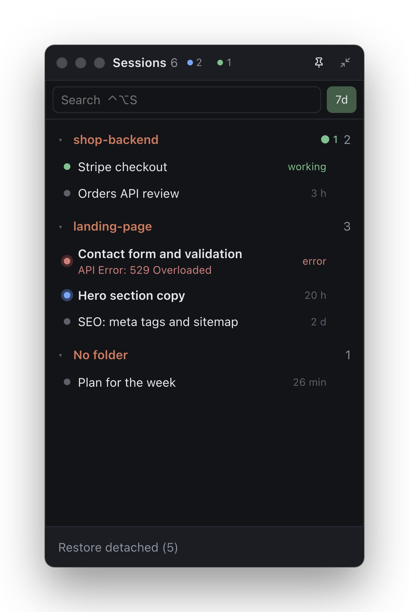

# Claude Sessions

A small always-on-top macOS window that lists the Claude desktop app's Code-tab sessions,
grouped by project, and shows at a glance which ones Claude is working in, which wait for
you (with the app's own one-line report), and which are stopped by the usage limit. Click a
session to switch the Claude app to it. It lives in the menu bar: no Dock icon, no ⌘Tab
entry.

<p align="center"></p>

Only local sessions are shown: the Claude app keeps cloud sessions on its server and writes
no list of them to disk. The widget only reads the app's files on your Mac and sends nothing
anywhere.

## Requirements

- macOS on Apple silicon or Intel, with the Claude desktop app and its Code tab in use.
- Node.js 22.12 or newer (the app packager needs it) and npm.
- Xcode Command Line Tools for the Swift helper and the icon: `xcode-select --install`.
  Without them `npm install` still works and `npm start` runs, but the widget cannot
  hide together with Claude, and `npm run package` stops with the same hint.

## Install

```bash
git clone https://github.com/BademusEv/active-claude-task-manager.git
cd active-claude-task-manager
npm install          # downloads Electron, compiles the Swift helper
npm run package      # builds and installs ~/Applications/Claude Sessions.app
open ~/Applications/"Claude Sessions.app"
npm run autostart    # optional: start at login, restart after a crash
```

The widget appears in the menu bar (no Dock icon) and as a panel at the top right of the
screen. macOS asks once whether «Claude Sessions» may send notifications.

- Update: `git pull`, then `npm run package` again; with autostart on, the new build
  starts by itself.
- `npm run autostart:remove` turns autostart off; delete
  `~/Applications/Claude Sessions.app` to remove the app.
- `npm start` runs the development build without packaging. Both builds keep their
  settings in `~/Library/Application Support/claude-sessions-widget/state.json`.

## What it shows

- **Groups** are project folders. A session in a git worktree goes under its project with a
  `⑂ branch` label; a session started from another one is indented under it.
- **Status dot**:
  - green, pulsing — Claude is working;
  - blue, bold title — waits for you: a question, a decision, or a finished turn you have
    not opened yet;
  - yellow — stopped by the usage limit, with the time it resets; it turns blue («Limit
    reset; you can continue») once it has;
  - red — stopped by an API error, with its text;
  - grey — nothing new.
- **Under a session that waits for you**, the Claude app's own report on the last turn:
  what it needs from you, or what it did.
- **Title bar counters** (blue: wait for you, green: working) filter the list by that
  status. `7d` hides sessions idle for over a week; the search box matches title, project
  and branch. ⌥-click on a group header folds or unfolds every group.
- **Right-click on a session**: open it, copy its link, show its folder in Finder or a
  Terminal, open its branch's pull request on GitHub, detach it from the list.

## Window and keyboard

- **Collapse** (top-right button) folds the panel into a small square that shows how many
  sessions wait for you. Rest the pointer on it to peek into the list; the expand button
  keeps it open. Drag the square by its edge. While collapsed, clicks around the square go
  through to the windows below.
- **Pin**: unpinned (the default), the widget hides when Claude is minimized or another app
  is in front, and comes back with Claude. Pinned, it stays on screen.
- **⌃⌥S** anywhere shows the panel with the cursor in the search; ↑/↓ pick a session, Enter
  opens it, Esc clears the search or hides the panel. Change the key with `hotkey` in
  `state.json` (an Electron accelerator).
- **Notifications** come when a session starts to wait for you or fails, unless Claude is
  in front; one notification covers every session a usage limit stops. Click one to open
  the session. Switch them off in the menu bar menu.
- **Menu bar icon**: the number of sessions waiting for you; its menu has Show window, the
  pin and notification switches, Language, Restore detached and Quit. The window's close
  button only hides it.
- **Language**: English by default, Russian in the menu bar menu (Language). Settings from
  versions before the switch keep Russian.

## Project layout

```
src/main.js            main process: sessions, statuses, tray, window, notifications
src/preload.js         bridge between the page and the main process
src/renderer/          the panel (HTML, CSS, JS)
src/i18n.js            every user-facing string, in English and Russian
helper/front.swift     reports the frontmost app (built to build/front)
scripts/               build, packaging, icon, LaunchAgent
```

## Documentation

- [AGENTS.md](AGENTS.md) — for coding agents: commands, how to check a change, where the
  data comes from, status rules, constraints and gotchas (source of truth).
- [CLAUDE.md](CLAUDE.md) — entry point for Claude Code; imports AGENTS.md.
